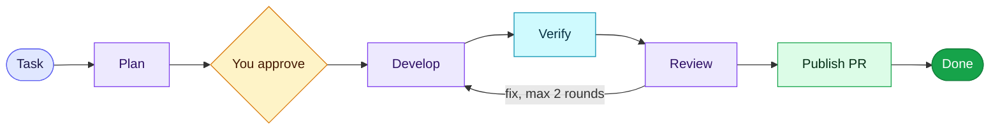
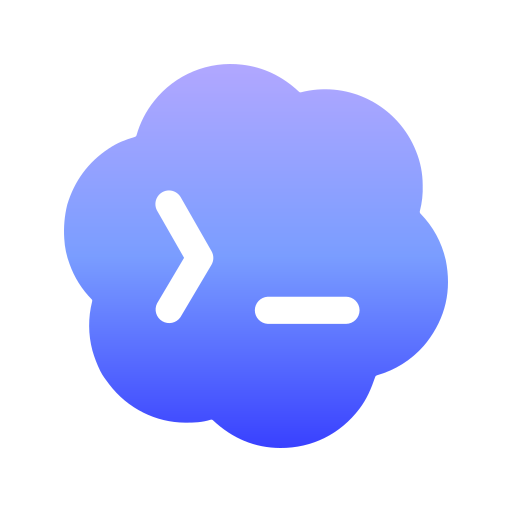

<div align="center">

# Workstream

### Plan, build, review and ship tasks with AI agents, from one desktop app

<p>
  
  
  
</p>
<p>
  
  
  
  
  
</p>

</div>

Workstream takes a task from a repository-aware plan, through development and an independent review, to a pull request on Azure DevOps or GitHub. You stay in charge at every gate.

## The flow



> [!IMPORTANT]
> The gates are enforced by the app, not by prompts. Nothing is published without an approved plan, passing checks and an independent review. Workstream never force-pushes, auto-merges or deletes your work.

## Agents

Each role (planner, developer, reviewer) can run on a different engine. All three follow the same rules and skills.

| | Engine | Sign-in |
|:-:|---|---|
|  | Codex | Your ChatGPT account |
|  | Claude | Claude Code sign-in or an API key |
| <picture><source media="(prefers-color-scheme: dark)" srcset="src/assets/brands/github-copilot-white-icon.svg"></picture> | GitHub Copilot | Your GitHub account with a Copilot plan |

## Highlights

| | |
|---|---|
| 🟣 Live cost | Spend per run and per agent, with your own price table |
| 🔵 Task location | See the worktree, branch and PR state for every task |
| 🟢 PR status | Spots completed PRs, pulls the target branch and removes the worktree for you |
| 🟠 Clear next steps | A "What needs to be resolved" panel explains why a run is waiting |
| 🔴 Clean branches | Test files the agents write are kept out of the PR |
| ⚪ Connectors | Read-only Jira, Confluence and Figma access over MCP |
| ⚫ Project memory | Local SQLite memory of past runs, plan feedback and review findings |

## Get started

> [!TIP]
> Already have a build? Open `release\Workstream <version>\Workstream.exe`. No terminal needed.

```powershell
npm ci
npm run build
npm start
```

Then, in the app:

1. Connect a repository under Projects and check its target branch.
2. Pick an engine and model for each role under Agents & models.
3. Create a task, read the plan and approve it.
4. Follow development, checks and review, then publish the PR.

> [!NOTE]
> You need Node.js 22+, Git and at least one signed-in engine. Publishing needs the Azure CLI (`az`) or the GitHub CLI (`gh`).

## Commands

| Command | What it does |
|---|---|
| `npm run dev` | Run the app with hot reload |
| `npm run dev:web` | Browser-only UI preview (no agents or Git) |
| `npm test` | Unit and Git integration tests |
| `npm run lint` | ESLint |
| `npm run package` | Build a Windows release into `release/` |
| `npm run copilot-runtime` | Fetch the bundled Copilot runtime before packaging |

<details>
<summary><b>Project structure</b></summary>

| Folder | Contents |
|---|---|
| `src/` | React UI. The preload only exposes typed, validated commands |
| `electron/` | Workflow engine, agent clients, Git worktrees, state and publishing |
| `shared/` | Data contracts and Zod validation |
| `skills/` | Role instructions for the planner, developer and reviewer |
| `tests/` | Vitest suites, many against real temporary Git repositories |

</details>

<details>
<summary><b>Data and security</b></summary>

- State lives in `%APPDATA%\workstream\state.json`. Set `WORKSTREAM_DATA_DIR` to use another folder, which the tests do.
- Worktrees go next to your repository, in `<repo>.worktrees\`.
- API keys and connector tokens are encrypted with Windows credential protection and never written to state or logs.
- Agents never see tokens. Connectors go through a local read-only proxy.
- After a restart, an interrupted run is marked as blocked and can continue from its saved worktree.

</details>

<details>
<summary><b>Known limits</b></summary>

- Live paid inference, browser verification and real PR creation are not covered by the automated tests.
- PR comments from reviewers are not read back yet. Change requests use your own notes.
- Windows only.

</details>

---

<div align="center">
<sub>Built for personal use by <a href="https://github.com/Dempaman">Dempaman</a></sub>
</div>
